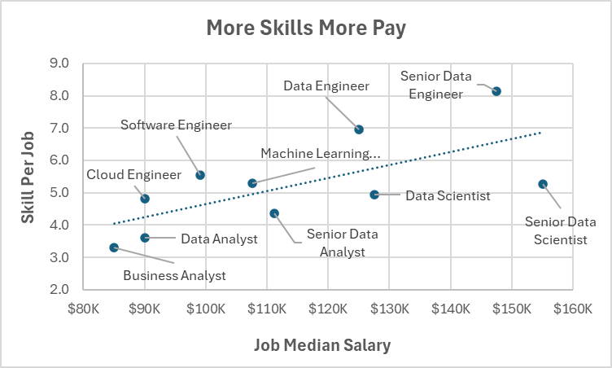

# Introduction  
This project 2 analysis focuses on data skills demand and pay analysis, using real world data set you can check the main data in this link: [Data Jobs Posting All](../Main%20Worked%20on%20Data/data_jobs_salary_all.xlsx).  
with the help of the power of Microsoft Excel buit in tools I've answered the main following question.  
# Questions To answer🔐
As a Data Analyst learner and a job sekker it's logiclly to ask:
1. Do more skills get you a better pay?  
2. What are the most highly demanded skills?
3. What is the data jobs salary in other regions?
4. How much the pay for the top optimal skills?  
# Excel Skills used🛠️
To answer the above questions I used tools as:   
- Pivot Tables  
- Pivot Charts  
- Power Query  
- Powe Pivot
- DAX  
# Project Analysis📊
## 1️⃣Do More Skills Get  Better Pay? 
### 🛠️Skills Used: Power Query(ETL), Power Pivot, Pivot Tables & Charts.
### 1. Extract
I used Power Query to extract [Data Jobs Posting All](/Data%20Analysis%20Using%20Excel/Main%20Worked%20on%20Data/data_jobs_salary_all.xlsx) (the main data) and create two queries:
- one with the data jobs salary all informations.
- the second is a query reference of the first one with additional transformations, listing only skills with associeted job_id.
### 2. Transform
Using Power Query to do some cleaning and transformations on both queries:  
**Salary Data jobs Query cleaning**  

  

**Job Skills Query Cleaning**  
  
*Noote this second query is reference of the first quey adding the transformations steps shown above to get each distinct skill name with it's assochieted job id.*  
### 3. Load  
After doing the transformation above here's how both queries look:  

**Salary Data jobs**  

  
  
**Jobs Skills**  
  

  
Then I've load the queries above into **Power Pivot** Data moduling to establish a relationship between the tables queries using job_id column.  
  
**Data Module Diagram View**  

  
### 4. 📊Visualise 
  
Using the power of **Pivot Tables Agregations Mesures and Charts** I was able to visualise some findings.  
  
  
  
### 💡Insights:
- As we  can see there is a positive corolletion between the number of skills and the job median salary.  
- For Data Engineers job roles it's highly recommanded to have more skills if you want more pay.
- For Data Science job roles they relatively demand intermediate number of skills with high pay.
- For Data Analysis job roles they demand fewer number of skills and they tend to offer relatively low pay.  

## 2️⃣What Are The Top Demanded Skills?
### 🛠️Skills Used: Pivot Tables , Pivot Charts & Slicers.
- The processus of solving this question it was much simpler then question1. building on the question1 second query   
1. First I loaded the second query (Job Skills) into a **Pivot table** using the **COUNT(job_skills)** Agregation function to count the skills accurance.  
2. then I've sorted the results to get the **Top 10 Most Demanded Skills.** Using the **job title slicer** it helped to filter for my role.  

  
*This work sheet image shows all the applied steps above.*📊  
### 💡Insights:
- **SQL And Excel** are leading the Data Analyst Role demanding skills, as they are the domaine traditionnel and old core fundemntal skills.  
- **Python And Tableau** are following they are closly equals. **Python** as a new  programming language emerging skill in the Data domaine. and **Tableau** as traditionnel Data Visualisation skill.  
- Finally comes some of the less important technical skills in the Data domaine like **Word And Powepoint**.
## 3️⃣What's The Data Jobs Salary In Other Regions?
### 🛠️Skills: Pivot Tables And DAX.
Loading the jobs salary data into Power Pivot, then into Pivot Tables I've Grouped the data BY the job_title short into rows.  
Then I  created some **DAX explicit mesures** 
1. Median salary for all countries:  
```
median_salary:=MEDIAN(data_jobs_salary[salary_year_avg])
```  
2. Median salary only for Unitted State:  
```
US_median_salary=CACULATE(
            MEDIAN(data_jobs_salary[salary_year_avg]),
            data_jobs_salary[job_country]="Unite 
            States")
```  
3. Median salary for all countries excepet US:  
```
non_US_median_salary=CACULATE(
            MEDIAN(data_jobs_salary[salary_year_avg]),
            data_jobs_salary[job_country]<>"Unite 
            States")
```  
4. Using Country Slicer can help us to folter for a spicified Country to compare it's median salary with US median salary and other Countries median salary(non US).
   

  
*This work sheet image shows all the applied steps above.*
### 💡Insights
- From the Pivot Table above we see that mostly in all Data jobs roles the US median salary is high in comparaison with the rest of the world countries.  
- Probably the raison of these differences in salaries is that the giant tech companies in the world are in United States Of America. spicialy in the Cilicon Valay zone.  
## 4️⃣What's The Pay Of The 10 Top Optimal Skills?  
### 🛠️Skills:Advanced Pivot Tables & Charts With Advanced DAX.
Using the same Data Model as before (skills jobs & data jobs salary).
1. I've created a Pivot Table I've put the jobs skills in rows to Group BY the skills names. and skill count DAX in the values .
2. Using a DAX advanced fuction named CROSSFILTER() to filter from the tow tables data model in both directions. then I calculate the skills median salary.
```
=CALCULATE(MEDIAN 
        data_jobs_salary[salary_year_avg]),
        CROSSFILTER(data_jobs_salary[job_id],
        data_jobs_skills[job_id],
        Both))
```
3. I selected the Top 10 skills that have the large skills count, and I Ordered them BY the skill median salary.  
4. To visualise the final results I've created an **Advanced Pivot Cambo Chart**, in it *Skills Count represented as a marker line* and *Skills Median Salary as a clustered column* puting the tow variables in sepereated axes.   

  
*This work sheet image shows all the applied steps above.*📊
### 💡Insights
- **Cloud skills (AWS,Azure...) are the highly paying**, becuase they're a highly specialised technologies and thier scope go beyond Data roles, but they're **low demanded** wish explain that **they're not the Basic Skills for Data Jobs Market**.  
- **SQL & Python** are the two highly demanded skills(demanded nearly 18000 times), also they're highly paying skills after Cloud skills. from that we can say they're as **fundamental Skills for Data Jobs Market**.
- Finaly comes **Visualisation & SpeadSheets Skills(Tableau,Power BI & Excel)** this doesn't say that they're less important but instead they considered as basic traditionnel as **Skills for Data Jobs Market**.
- For Data Job Market seeker it's highly recommende to start with the basic fundamental skills then swift gears into more spicialised skills.
# Conclusion
This project was a course practice idea project. working on this real world data nerds jobs market data give a preciece snapchat ideas on the jobs market demands, skills and slaries.  
While mastering some deep Excel tools such Power Query, Power Pivot, DAX, Advanced Pivot Tables & Charts.


